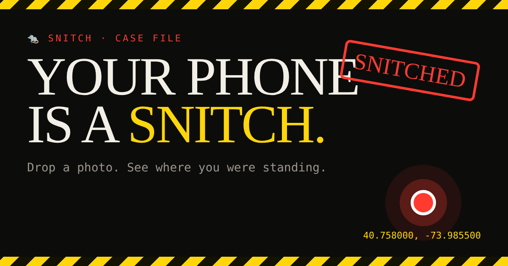

# 🐀 Snitch

**Your phone is a snitch.** Find out what it told on you.



**Live:** https://alpha404ai.github.io/snitch/

Two tools, one page each. No install, no sign-up, no server. Everything runs in your browser.

## Photo Snitch

Drop a photo and see what's hidden inside it:

- GPS pin on a map, accurate to a few meters, plus the nearest street address
- Which way the camera was facing, and the altitude
- Phone model, iOS/Android version, whether it was the selfie camera
- Date and time down to the second, with timezone
- Serial numbers and owner names, if the camera wrote them

Then hit **Wipe & download** to get a copy with zero metadata. The page re-checks the new file and tells you how many tags are left (it should say 0).

**When does a photo still have GPS?** Most social apps (X, Instagram, regular Telegram photos) strip it on upload. The originals keep it: photos sent "as a file", by email, over AirDrop, through Google Drive or Dropbox, or downloaded from your cloud backup.

## Browser Snitch

Open the page and don't click anything. It lists what any website can read the moment you land on it:

- IP address, city, internet provider, and a VPN check (IP timezone vs your system clock)
- GPU, CPU threads, RAM, screen, battery level and charging state, connection speed
- Your languages, where you came from, dark mode, ad blocker, installed Office/Adobe/coding fonts
- Live counters: time on page, how far your mouse traveled, how often you left the tab
- A fingerprint ID built from your hardware. On most browsers it stays the same in incognito.

## Privacy

- Photos are read locally with [exifr](https://github.com/MikeKovarik/exifr). They never get uploaded.
- Photo Snitch sends only the coordinates (not the photo) to OpenStreetMap Nominatim to turn them into an address.
- Browser Snitch makes one request to [ipwho.is](https://ipwho.is) to turn your IP into a city. Nothing else leaves the page.
- Satellite map tiles come from Esri, with OpenStreetMap as a fallback.
- No analytics, no cookies. The only thing stored is a visit counter in your own browser's localStorage.

## Run it yourself

It's plain HTML, CSS and JS. Clone it and open `index.html`, or serve the folder:

```bash
git clone https://github.com/alpha404ai/snitch
cd snitch
python3 -m http.server 8000
```

To host your own copy: fork, then **Settings → Pages → Deploy from a branch → main / (root)**.

## Built with

- [exifr](https://github.com/MikeKovarik/exifr) (MIT) for reading photo metadata
- [Leaflet](https://leafletjs.com) (BSD-2) for the map

## Use it on your own stuff

This exists to show how much leaks by default. Check your own photos and your own browser.

MIT License.
